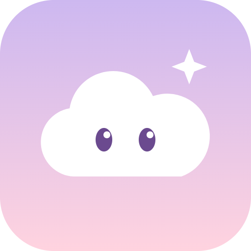

# Fuwa Mint

Tell a fluffy cloud Bot how you feel, and get a glowing sticker.

- ▶ **Try it:** https://0x-xrpl.github.io/my-idea-1010/
- 📄 **Pitch deck (PDF):** [pitch.pdf](pitch.pdf)

## About

### A gentle way to end the day

At bedtime, it is hard to look back on your day. Fuwa Mint makes it soft and easy by turning it into a chat with a cloud.

- Made for a short look back at your day before sleep
- Your friend is a fluffy cloud Bot with a soft glow
- Calm pink and lavender sunset colors, not a game
- A Solana-style feel, but only a demo: no real wallet or money

### How Fuwa Mint works

Write one small thing to the Bot, tap Fluffy Mint, and your feeling becomes a sticker with a letter.

- Type a feeling or tap a sample chip on the main screen
- A meter shows how rare your sticker may become
- Demo wallet and demo mint: a short progress screen, then a sticker
- Cloud Bot gives you a letter; stickers are kept in your book

### Why it matters, and next

Feelings you share become something kind to keep. The rarity follows how much you open up, not how well you play.

- A warm habit: talk, receive a letter, sleep well
- Rarity changes with your feelings: soft, sparkle, rainbow
- Works in Japanese and English
- Next: a name polish and more ways to grow with your Bot

## How it was made

Built by shaping the idea together with AI (Claude) and publishing the AI-written code.
The full conversation is in [IDEA.md](IDEA.md) (Japanese).

## Files

- `index.html` — the app (a single self-contained file)
- `IDEA.md` — the idea log
- `pitch.pdf` — the pitch deck
- `assets/logo.png` — the logo
